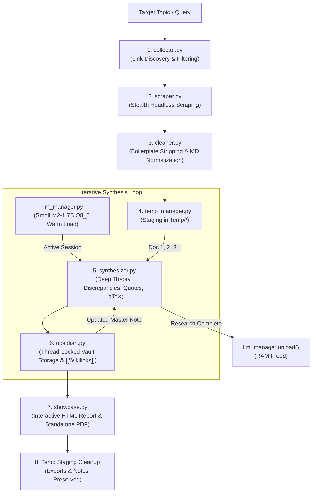

# Researcher — Autonomous Deep Textual Research Engine & MCP Server

[](https://www.python.org/)
[](https://modelcontextprotocol.io/)
[](https://obsidian.md/)
[](LICENSE)

An independent, production-grade autonomous research agent and Model Context Protocol (MCP) server. **Researcher** conducts iterative, multi-source deep investigations on technical topics, extracts mathematical rigor, prevents AI false-consensus, captures uncorrupted primary quotes, builds interconnected Obsidian knowledge graphs, and compiles publication-quality HTML & PDF showcase reports.

Designed as both a **standalone CLI / Python library** and a **plug-and-play stdio MCP Server** for AI hosts like Claude Desktop, Cursor, Antigravity, and ALFRED.

---

## 📖 About Researcher

**Researcher** is an autonomous deep research engine engineered to solve the primary failure modes of AI-assisted investigation: hallucinated consensus, context saturation, superficial summaries, and anti-bot search blocks.

Unlike conventional search-and-summarize scripts that condense entire websites into lossy bullet points, Researcher acts as an automated investigative analyst:
- **Resilient Multi-Tier Harvesting**: Bypasses bot verification and Cloudflare challenges using Obscura's embedded V8 stealth browser engine backed by Bing base64 search fallback, requiring zero cloud search API subscriptions.
- **Truth Preservation & Discrepancy Tracking**: Explicitly catalogs conflicting numbers, historical dates, and rival scientific claims into a dedicated `## Discrepancies` ledger with primary source attribution, eliminating false AI consensus.
- **Mathematical & First-Principles Rigor**: Extracts formulas and renders them in KaTeX/LaTeX (`$$...$$`), standardizing metric units, variable definitions, and step-by-step mathematical reasoning.
- **Persistent Knowledge Graphing**: Ingests findings directly into an Obsidian markdown vault using bidirectional `[[Wikilinks]]` and dynamic graph maps (`Knowledge_Graph.md`), enabling persistent long-term knowledge accumulation across sessions.
- **Publication-Ready Outputs**: Automatically formats, typesets, and renders publication-quality HTML and printable PDF executive dossiers using headless Chrome.
- **Universal Dual Interface**: Functions both as an interactive/batch CLI tool and as a compliant **Model Context Protocol (MCP)** server for Claude Desktop, Cursor, Antigravity, and ALFRED.

---

## Table of Contents

- [About Researcher](#-about-researcher)
- [Architecture Overview](#-architecture-overview)
- [Key Features & Guardrails](#-key-features--guardrails)
- [Repository Structure](#-repository-structure)
- [Dedicated LLM Subsystem](#-dedicated-llm-subsystem)
- [Core Components](#-core-components)
- [Installation & Setup](#-installation--setup)
- [Usage Guide](#-usage-guide)
  - [1. Standalone CLI](#1-standalone-cli)
  - [2. Python Package API](#2-python-package-api)
  - [3. Stdio Model Context Protocol (MCP) Server](#3-stdio-model-context-protocol-mcp-server)
- [Obsidian Knowledge Graph Integration](#-obsidian-knowledge-graph-integration)
- [Showcase Reports & PDF Export](#-showcase-reports--pdf-export)
- [Testing](#-testing)
- [Configuration Reference](#-configuration-reference)

---

## Architecture Overview

Researcher follows a sequential, multi-stage pipeline designed to eliminate context saturation and prevent information erasure:



---

## Key Features & Guardrails

1. **The "False Consensus" Protection**:
   - Standard LLM research often smooths over contradictory dates, numbers, or claims into a synthetic consensus.
   - Researcher maintains a dedicated `## Discrepancies` section in every note. When conflicting data appears across sources, it explicitly catalogs the disagreement alongside respective source citations.

2. **The "Quote Erasure" Protection**:
   - High-value statistics, experimental readings, and primary remarks are preserved verbatim in Markdown blockquotes (`>`), citing exact URLs rather than loosely paraphrasing.

3. **Mathematical & Theoretical Rigor**:
   - Theoretical concepts are grounded in first principles.
   - Equations are rendered in KaTeX / LaTeX math format (`$$...$$`), complete with variable definitions, metric units, and step-by-step worked calculations.

4. **Bi-directional Knowledge Graphing**:
   - Automatically cross-links concepts, entities, and physical laws using Obsidian `[[Wikilinks]]`.
   - Maintains an updated `Knowledge_Graph.md` index connecting all master notes and child entities.

5. **Clean Stdio MCP Server**:
   - Conforms to the Anthropic Model Context Protocol specification.
   - All logging is directed strictly to `sys.stderr` and rotating file logs, leaving `sys.stdout` clean for JSON-RPC messages.

6. **Automated Clean Storage**:
   - Intermediate raw HTML and partial markdown files are staged in `Temp/<topic>/` during synthesis.
   - Upon completion, `Temp/` is automatically scrubbed, while permanent reports in `Exports/` and markdown files in `Vault/` are kept.

---

## Repository Structure

```
Researcher/
├── .gitignore             # Ignores Vault/, Temp/, models/, logs/, bin/, pycache
├── README.md              # Complete technical documentation
├── download_model.py      # Downloader for SmolLM2-1.7B-Instruct-Q8_0.gguf
├── context_limiter.py     # Semantic context chunking and CPU acceleration
├── llm_manager.py         # Dedicated LLM manager (persistent load, ChatML, synthesis)
├── logger.py              # Stderr + rotating file logger (protects MCP stdio)
├── collector.py           # Stage 1: Link harvesting and relevance discovery
├── scraper.py             # Stage 2: Headless Obscura / HTTP scraping
├── cleaner.py             # Stage 3: Noise, script, and navigation stripping
├── temp_manager.py        # Stage 4: Staged intermediate storage with auto-cleanup
├── synthesizer.py         # Stage 5: Iterative LLM synthesis & guardrails
├── obsidian.py            # Stage 6: Thread-locked Obsidian vault manager
├── showcase.py            # Stage 7: Publication HTML web view and PDF generation
├── pipeline.py            # Master orchestrator coordinating Stages 1-7
├── cli.py                 # Terminal CLI entrypoint
├── server.py              # Standalone stdio MCP server (JSON-RPC)
├── models/                # Local GGUF models (e.g. SmolLM2 Q8_0, ignored)
├── Exports/               # Permanent HTML and PDF reports (ignored)
└── Vault/                 # Obsidian notes & Knowledge Graph (auto-created, ignored)
```

---

## Dedicated LLM Subsystem

Researcher uses a completely decoupled local LLM subsystem powered by **SmolLM2-1.7B-Instruct-GGUF (q8_0)**:

- **Model**: `bartowski/SmolLM2-1.7B-Instruct-GGUF` (`SmolLM2-1.7B-Instruct-Q8_0.gguf`)
- **Key Parameters**:
  - `n_ctx = 8192` (full 8k token context window)
  - `n_batch = 1024`
  - `n_threads = 4`
  - `type_k = GGML_TYPE_Q8_0` (8-bit KV cache for high fidelity)
  - `type_v = GGML_TYPE_Q8_0` (8-bit KV cache for high fidelity)
  - `flash_attn = True`
  - `verbose = False`
  - `temperature = 0.2`
  - `min_p = 0.05`
- **Smart Lifecycle Management**:
  - The model is loaded into RAM once at the start of the sequential synthesis loop.
  - Remains warm across all staged documents and chunks.
  - Automatically unloads from RAM (`llm_manager.unload()`) in a `finally` block when the research run finishes, releasing ~2 GB of memory back to the operating system and ALFRED.
- **`ResearchContextManager`**:
  - Builds structured ChatML (`<|im_start|>`) prompts.
  - Enforces domain guardrails, LaTeX mathematical rigor (`$$...$$` and `$..$`), Markdown property tables, primary blockquote retention, and Obsidian wikilinks.
- **`ResearchSynthesizer`**:
  - Executes local inference with specified sampling bounds and cleans trailing incomplete tokens.

---

## Core Components

### 1. `collector.py` (Stage 1)
- **`collect_links_from_search(query, max_results)`**: Queries DuckDuckGo HTML endpoint without external API dependencies.
- **`collect_links_from_content(html_or_md, base_url)`**: Harvests anchor tags and markdown links from fetched pages.
- **`filter_relevant_sublinks(sublinks, topic, max_links)`**: Tokenizes and scores discovered links against the research topic to eliminate unrelated navigation items.

### 2. `scraper.py` (Stage 2)
- **`fetch_url(url, timeout)`**: Fetches website content using a multi-tier fallback:
  1. *Tier 1*: Headless `obscura.exe` with stealth mode (bypasses bot challenges and renders dynamic client-side JS).
  2. *Tier 2*: High-performance asynchronous/synchronous `httpx` GET with user-agent rotation.
- **`fetch_urls_parallel(urls, max_workers)`**: Concurrent fetching via `ThreadPoolExecutor`.

### 3. `cleaner.py` (Stage 3)
- **`clean_markdown_formatting(text)`**: Removes UI artifacts, button texts, "Sign In" badges, cookie banners, and excessive blank lines.
- **`strip_html_tags(html_content)`**: Converts raw HTML to clean plaintext while preserving header hierarchies and list structures.
- **`format_research_note(raw_content, url, title, max_words)`**: Formats raw text into a standard staging bundle with source metadata.

### 4. `temp_manager.py` (Stage 4)
- **`TempResearchStorage(topic)`**: Creates safe slug-based staging folders (`Temp/<topic_slug>/`).
- **`save_page_data(...)`**: Writes atomic `.json` and `.md` files for each harvested site.
- **`load_all_staged()`**: Orders staged files so root/main topic pages are synthesized prior to sublinks.
- **`clear()`**: Safe recursive deletion of temporary staging artifacts upon pipeline finish.

### 5. `llm_manager.py` (LLM Subsystem)
- **`ResearcherLLM`**: Singleton managing SmolLM2-1.7B-Instruct-Q8_0 with 8192 context window, 4 threads, flash attention, and Q8_0 KV cache. Loads once for research session, unloads to free RAM on completion.
- **`ResearchContextManager`**: Builds ChatML prompt with strict scientific guardrails, LaTeX math rules, property tables, and blockquotes.
- **`ResearchSynthesizer`**: Runs inference with temperature=0.2 and min_p=0.05, sanitizing output and balancing math fences.

### 6. `synthesizer.py` (Stage 5)
- **`synthesize_and_update(topic, new_doc, note_title)`**: Feeds each new document into the LLM alongside the existing Obsidian note to iteratively expand depth.
- **`build_system_prompt()`**: Injects non-negotiable rules for first-principles explanation, KaTeX math blocks, and quote retention.
- **`detect_conflicts(old_text, new_text)`**: Inspects numerical facts and dates to populate `## Discrepancies`.

### 7. `obsidian.py` (Stage 6)
- **`ObsidianVault(vault_path)`**: Thread-safe vault driver using file-level mutexes (`filelock`).
- **`store_note(...)`**: Generates YAML frontmatter, tags, metadata, and writes markdown notes.
- **`update_knowledge_graph_index(...)`**: Maintains `Knowledge_Graph.md` tracking graph connections across all notes.
- **`query_vault(search_query)`**: Full-text keyword search across all `.md` files in the vault.

### 8. `showcase.py` (Stage 7)
- **`generate_web_view(note_title, auto_open, create_pdf)`**:
  - Compiles note markdown, LaTeX formulas, discrepancy tables, and reference links into a responsive, clean single-page HTML report.
  - Generates standalone, print-perfect PDFs using headless Google Chrome or Microsoft Edge with zero orphan page breaks.

---

## Installation & Setup

### Prerequisites
- Python 3.10 or higher.
- Google Chrome or Microsoft Edge (for automated PDF report generation).

### 1. Clone & Install Dependencies
```bash
git clone https://github.com/Coder-H-1/Researcher.git
cd Researcher

# Install dependencies
pip install -r requirements.txt
```

*Requirements (`requirements.txt`):*
```txt
httpx>=0.27.0
filelock>=3.13.0
orjson>=3.9.0
llama-cpp-python>=0.3.0
huggingface_hub>=0.20.0
```

### 2. Download SmolLM2 Model (q8_0)
Download the dedicated research model (`SmolLM2-1.7B-Instruct-Q8_0.gguf`, ~1.8 GB) into `Researcher/models/`:

```bash
python Researcher/download_model.py
```

---

## Usage Guide

### 1. Standalone CLI

Run deep research directly from the command line:

```bash
# Basic topic research (analyzes top 3 sites)
python -m Researcher.cli "Electromagnetic Induction"

# Specify custom inputs, depth, and auto-open report in browser
python -m Researcher.cli "Quantum Teleportation" --inputs "https://en.wikipedia.org/wiki/Quantum_teleportation" --max-sites 5 --open

# Direct to a custom Obsidian Vault directory
python -m Researcher.cli "Solid State Batteries" --vault "D:/MyObsidianVault"
```

**CLI Output Example:**
```
[*] Starting research on: 'Quantum Teleportation' across up to 3 sources...
[+] Research completed successfully!
    Topic:          Quantum Teleportation
    Vault Location: C:\Workspace\Vault\
    Note Created:   C:\Workspace\Vault\Research_Quantum_Teleportation.md
    Sources:        3
    Web View:       C:\Workspace\Researcher\Exports\Report_Research_Quantum_Teleportation.html
    PDF Export:     C:\Workspace\Researcher\Exports\Report_Research_Quantum_Teleportation.pdf
    Duration:       14.2s
```

---

### 2. Python Package API

Use Researcher as an embedded library inside your own applications:

```python
from Researcher.pipeline import ResearchPipeline

# 1. Initialize pipeline for a topic
pipeline = ResearchPipeline(topic="Photosynthesis Light Reactions")

# 2. Run iterative research
result = pipeline.run_iterative_research(
    inputs=["Photosynthesis Light Reactions"],
    max_sites=3,
    auto_open_report=False
)

print("Status:", result["status"])
print("Vault Note:", result["note_file"])
print("PDF Report:", result["report_pdf"])
```

Reading and querying existing notes in the Vault:

```python
from Researcher.obsidian import ObsidianVault

vault = ObsidianVault()

# Search for notes
results = vault.query_vault("ATP synthase")
for res in results:
    print(f"Found match in {res['title']} (relevance score: {res['score']})")

# Read note content
note_data = vault.fetch_note("Research_Photosynthesis_Light_Reactions")
print(note_data["content"])
```

---

### 3. Stdio Model Context Protocol (MCP) Server

Researcher implements the MCP specification over standard I/O (JSON-RPC), exposing 3 core tools to any MCP host.

#### Starting the Server
```bash
python server.py
```

#### Available MCP Tools

| Tool Name | Parameters | Description |
| :--- | :--- | :--- |
| `deep_research` | `topic` *(string, required)*<br/>`max_sites` *(int, default 3)* | Executes complete deep research pipeline, writes to Obsidian Vault, cleans staging, and creates exports. |
| `terminate_research` | `topic` *(string, optional)* | Terminates background research, unloads the model from RAM to free memory, and cleans topic Temp files (or all Temp files). |
| `list_vault_notes` | *None* | Lists all research notes present in the Obsidian Vault. |
| `read_vault_note` | `note_title` *(string, required)* | Retrieves raw Markdown content of a specific note from the vault. |

#### Example: Configuring in Claude Desktop / Cursor
Add to your `claude_desktop_config.json`:

```json
{
  "mcpServers": {
    "researcher": {
      "command": "python",
      "args": ["-3.14", "C:\\Workspace\\Researcher\\server.py"],
      "cwd": "C:\\Workspace\\Researcher"
    }
  }
}
```

#### Example: Configuring in ALFRED's `MCP/mcp_servers.json`
```json
{
  "mcpServers": {
    "researcher": {
      "command": "py",
      "args": ["-3.14", "server.py"],
      "cwd": "Researcher",
      "enabled": true,
      "description": "Standalone deep research MCP server with Obsidian vault and reports"
    }
  }
}
```

---

## Obsidian Knowledge Graph Integration

Every note generated by Researcher is directly compatible with [Obsidian](https://obsidian.md/):

- **Automatic Vault Initialization**: If the `.obsidian/` configuration folder does not exist, Researcher sets up directory metadata automatically.
- **YAML Frontmatter**: Includes timestamps, topics, source URLs, tag taxonomy, and synthesis passes.
- **Wikilinks**: Entities and concepts are wrapped in `[[Concept Name]]`, populating Obsidian's interactive graph view.
- **Knowledge Graph Index**: An auto-updating `Knowledge_Graph.md` provides a central navigational hub connecting all research notes.

```markdown
---
title: Research_Electromagnetic_Induction
tags:
  - research
  - synthesis
  - electromagnetic_induction
sources:
  - https://en.wikipedia.org/wiki/Electromagnetic_induction
updated_at: 2026-11-03T19:30:00
---

# Research: Electromagnetic Induction

## Core Theory & Mechanisms
Electromagnetic induction is governed by [[Faraday's Law]] and [[Lenz's Law]]...
```

---

## Showcase Reports & PDF Export

Generated reports in `Exports/` are built for maximum readability and executive presentation:

- **Typography & Layout**: Clean white background, 15px screen body, responsive CSS grid for related sub-topics, and syntax-highlighted code.
- **KaTeX / MathJax Math**: Beautiful mathematical equations with boxed formula containers.
- **Headless Browser PDF Generation**: Automates Chromium/Edge via `--headless --print-to-pdf` with page margins and page breaks calibrated to eliminate orphan lines.

---

## Testing & Validation

The Researcher subsystem components support testing and validation across link collection, boilerplate stripping, Obsidian thread locking, and end-to-end multi-site synthesis pipelines. Test suites can be executed locally during verification.

---

## Configuration Reference

Researcher can be configured via environment variables or direct arguments:

| Environment Variable | Default | Description |
| :--- | :--- | :--- |
| `RESEARCHER_MODEL_PATH` | `Researcher/models/SmolLM2-1.7B-Instruct-Q8_0.gguf` | Path to local GGUF model for synthesis. |
| `RESEARCHER_VAULT_DIR` | `./Vault` or `../Vault` | Absolute path to the destination Obsidian Vault. |
| `RESEARCHER_MAX_WORDS` | `45000` | Word ceiling to respect LLM context budgets (e.g. 64k tokens). |
| `OBSCURA_BIN_PATH` | `./bin/obscura.exe` | Path to local Obscura stealth browser executable. |
| `CHROME_BIN_PATH` | Auto-detected | Path to Google Chrome or Microsoft Edge binary for PDF printing. |

---

## License

MIT License. Free for open-source and commercial use.

